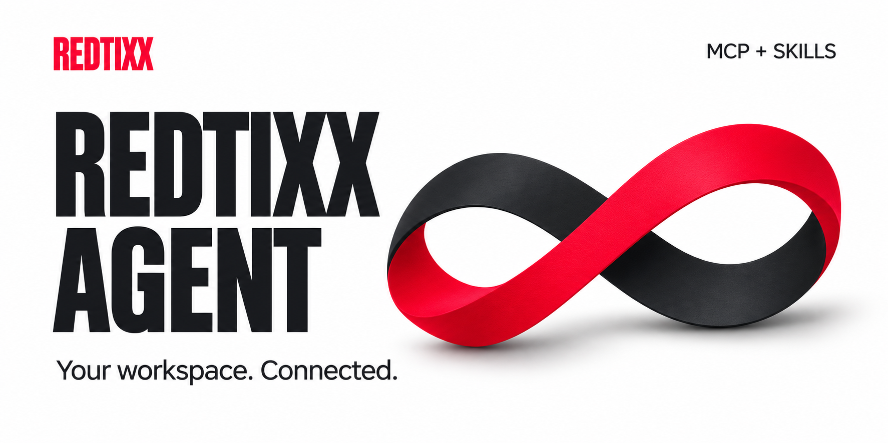

# REDTIXX Agent

Подключите своего AI-агента к Redtixx. Создавайте и редактируйте мероприятия и услуги в чате.

[Установить →](INSTALL.md) · [Плагин](plugins/redtixx) · [Скачать](https://github.com/namesEnded/redtixx-agent/releases)

## Что умеет

- Создавать черновики, описания и переводы RU/EN.
- Настраивать расписание, тарифы, квоты и анкету покупателя.
- Работать с медиа и готовить превью обложек.
- Проверять готовность и отправлять объект на модерацию по подтверждению организатора.

Организатор работает со своей организацией. Администратор — со всеми организациями; владельца нового объекта указывает в команде.

## Установка через агента

Скопируйте запрос в **Codex** и добавьте MCP-адрес из кабинета Redtixx:

```text
Установи REDTIXX Agent по инструкции:
https://github.com/namesEnded/redtixx-agent/blob/main/INSTALL.md

MCP-адрес: <вставьте адрес из кабинета Redtixx>

Сохрани остальные настройки. Помоги пройти OAuth в браузере.
После подключения проверь роль и права через get_context.
Не проси присылать пароли, коды аутентификатора или токены в чат.
```

Понадобятся Node.js 20+, Git и актуальный Codex CLI с поддержкой плагинов. Публикация в общем каталоге Codex не требуется.

## Доступ

По умолчанию подключение выдаёт чтение. Создание и правки включаются при авторизации. Модерация и публикация от лица администратора через MCP недоступны.

Генерация изображений использует возможности вашего AI-клиента. Локальное превью обложек настраивается при первом использовании; для точной типографики нужен файл Druk от вашей команды Redtixx.

**Первый выпуск поддерживает Codex.** Инструкция для Cursor появится после проверки его установки.
